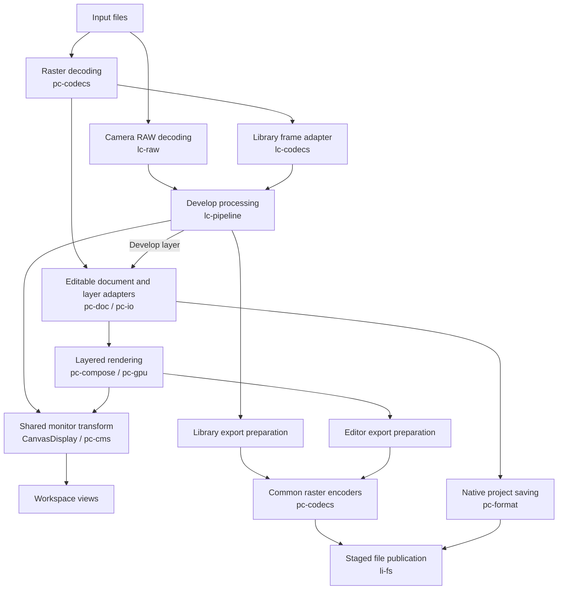
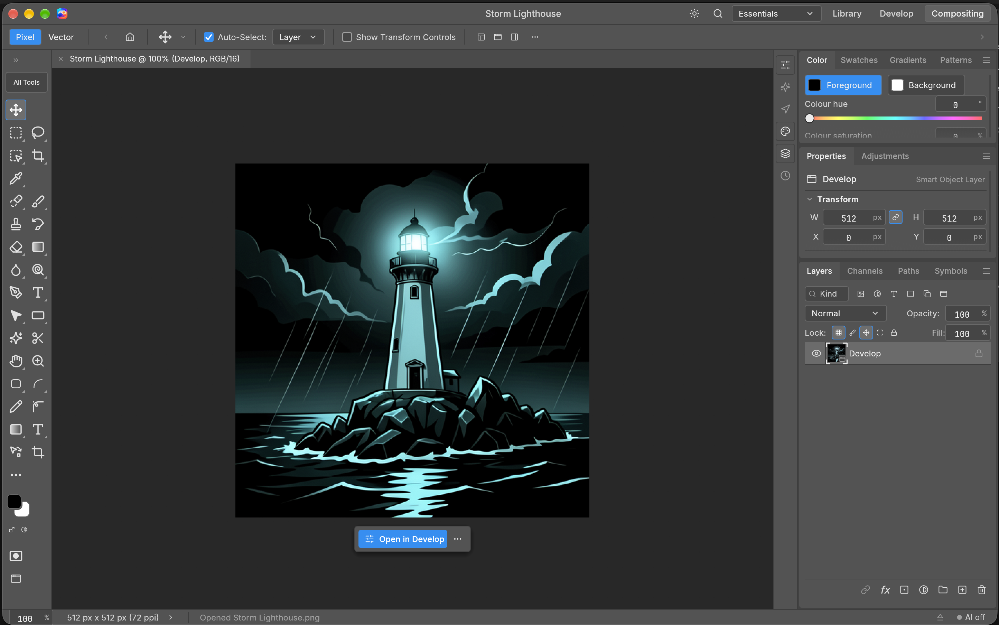
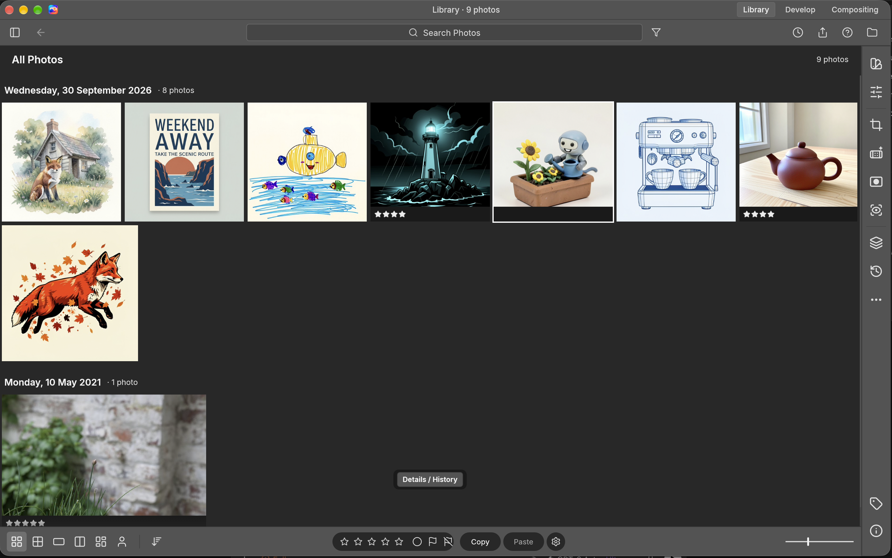
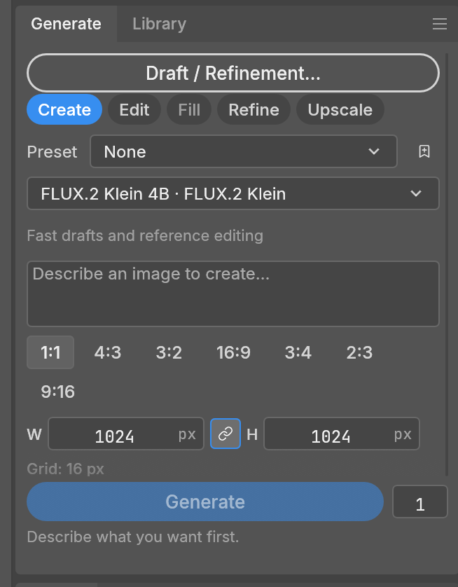

# Local Image 2

**A native workspace for photo cataloguing, RAW development, layered editing, vector design and AI.**

**Current version:** 2.0.0-alpha.1 · **Supported platforms:** Linux x86_64 and Apple Silicon macOS 13+

[Features](#major-features) · [Tools](#tools-and-workflows) · [Under the hood](#how-the-pieces-fit-together) · [Interface](#interface) · [Install](#install-or-build)

[Security](SECURITY.md) · [Privacy](PRIVACY.md) · [Changelog](CHANGELOG.md)

## Major features

### Catalog and photo management

Browse folders in place or import photos into a Library. Rate, flag, label and keyword images; organize collections and smart collections; filter a shoot, compare frames and export selected work. Smart Sort adds optional on-device scene classification and opt-in face grouping. XMP sidecars carry supported metadata and development settings between files and the catalog.

### Develop panel and RAW processing

Develop camera RAW files with tone, colour, optics, detail and local-mask controls. Work with presets, film negatives, HDR brackets and panoramas. A **Develop layer** brings the original and its settings into Compositing, keeping the in-app connection to later Develop edits without requiring an intermediate TIFF.

### AI generative suite

The Generate panel combines **Create, Edit, Fill, Refine and Upscale**, with model presets, image references, LoRAs, Draft → Refine and custom ComfyUI workflows. Open results as documents, place them as layers or reuse them as references. AI Remove, background removal, Generative Fill and background generation are available from the editing workflow.

Connect a local or remote **ComfyUI** server; **Find on LAN** helps locate one. A remote GPU server is the practical option for large generative models on Apple Silicon. Optional OpenAI, Google, Black Forest Labs and Stability AI adapters use your own keys and provider billing. Requested remote/cloud operations send their inputs to the selected service.

### Layered photo editing and compositing

Combine image layers, groups, masks, clipping, adjustment layers, blend modes, effects, smart objects and editable type. Paint, select, heal and transform with familiar tools and customizable shortcuts. The editor supports 8-, 16- and 32-bit colour and ICC-managed display/export. Save the editable master as `.pcraft`, then export a delivery copy.

### Vector design

Switch to the Vector persona for paths, nodes, shapes, corners, strokes, appearance stacks, text on paths, artboards and layout. Build reusable artwork with symbols, repeats, blends and styles; trace images and work with vector effects. SVG/PDF import/export and limited Affinity import connect this work to other applications.

### On-device assistance and automation

Function-labelled model setup covers Subject & Background, Sky, Depth, Smart Sort, Faces, Raw Denoise, RGB Denoise and local AI Remove. Models are separate downloads with their own licences. Native RAW and RGB AI denoise require a supported GPU. Core editing needs no AI server or cloud account; supported on-device operations keep image processing on the computer.

The bundled CLI handles conversions, commands, actions, batch jobs and Library workflows. MCP supports headless sessions and a bridge to the desktop app with explicit filesystem permissions.

### From a folder to a finished image

Start in Library to browse or import a shoot and choose the frames to work on. Develop keeps adjustments as settings, so you can revisit tone, colour and masks. When the image needs layers, graphics or detailed retouching, open it in Compositing as a Develop layer, then add pixel, vector and type work around it. Keep the `.pcraft` project for later editing and export a colour-managed delivery copy with the required size, profile and metadata.

The workspaces share a host and common services, but retain the controls suited to each job: catalog decisions in Library, photographic parameters in Develop, and explicit layer/object editing in Compositing. Batch actions, presets and CLI commands provide repeatable routes once the individual edit is right.

## Tools and workflows

The lists below describe the native V2 interface. Some commands require an appropriate document, selection, model or connected server; optional SAM 3 support is off in normal packages.

<details>
<summary>Catalog and Library</summary>

- **Import and browsing:** Add Photos; Add Folder; Import from Device (where the host exposes a device source); import by Add, Copy, Move or Copy as DNG; destination/rename/organize options and a verified second copy; Auto Import from a watched folder; persistent libraries; collections, folders and smart collections; Photo Grid, Square Grid, Detail, Compare, Survey, Reference and People views; filmstrip; Navigator; fullscreen preview; Lights Out; before/original, side-by-side and split comparison; histogram, clipping indicators and soft proofing.

- **Organization and discovery:** ratings; Pick/Reject/unflagged flags; color labels and editable label sets; search and filter bar; smart collection rules; sort and shuffle; selected-photo and visible-photo operations; stacks; Auto-Stack by Capture Time; virtual copies; duplicate photos; versions; activity/history; assisted culling; Find Similar; Smart Sort scene recognition; People/face grouping and naming (model-dependent); keywords and Keyword Painter; metadata inspection, copy/paste and metadata presets; rename; capture-time correction; GPS tagging from tracklog; show original in Finder; Recently Deleted, restore and permanent deletion.

- **Edit management:** Auto Settings; Match Total Exposure; treatment/color versus B&W; Reset Edits; copy all or selected settings; paste selected settings; Sync Settings and Auto Sync; create/import/export presets; profile and LUT management; rotate/flip; Convert to DNG; Sony Pixel Shift Merge; HDR Merge; Panorama Merge; HDR Panorama Merge.

- **Library maintenance:** standard-sized and 1:1 previews; smart previews and discard; preview-cache discard; locate/relink missing photos; verify/optimize and compact library; backup/restore; automatic backups; XMP write/read and automatic metadata write. Original RAW save-over writes a JPEG beside the RAW, rather than rewriting RAW data.

Implementation: [Library interface](crates/lc-ui-egui/src/menus.rs) · [Library commands](crates/lc-engine/src/cmd).

</details>

<details>
<summary>Develop and RAW tools</summary>

- **Edit sections:** Light; Tone Curve; Color; Color Mixer; B&W Mixer; Color Grading; Effects; Vignette; Grain; Detail; Optics; Geometry; Profile; Calibration; Point Color; Red Eye; Negative; Raw Processing; Lens Profile; Tone Equalizer; Color Calibration; Skin Tone.

- **Photo tools:** White Balance Selector; targeted tone/color adjustment; Point Color picker; Crop, Straighten and Guided Upright; rotate/flip; aspect-ratio crop; lens-profile correction; optical distortion/chromatic-aberration correction; demosaic selection and highlight reconstruction; capture sharpening; local contrast/haze/detail controls; film-negative conversion with Film Base sampling; Red Eye and Pet Eye correction; presets, profiles, LUT looks and versions.

- **Retouch:** Remove (pixel-based); Heal; Clone; AI Remove; regenerate AI removal; Find Dust Spots; Visualize Spots; source refresh and spot editing. AI/Remove/Heal/Clone are separate choices in the Remove panel.

- **Local layers/masks:** New Filled Layer; New Empty Layer; Brush; Linear Gradient; Radial Gradient; Color Range; Luminance Range; Subject; Background; Sky; Depth Range; add/subtract/intersect components; invert; Refine Edges; duplicate/rename/reorder/delete mask or components; per-layer opacity; local adjustment sliders and layer-capable Develop sections; mask overlays and pins. Subject/Background/Sky/Depth use installed selection models for learned results; classical fallbacks exist for some automatic shapes. Object (click prompting) and Describe (text prompting) require an optional SAM-enabled build and separately installed/licensed SAM 3 model: normal builds do not enable SAM.

- **AI Denoise:** native RAW and RGB AI denoise require a supported GPU, installed models and compatible input. Preview and DNG/TIFF output workflows are available. The CPU implementations are validation references, not a production fallback. Faithful/Rescue enlargement can also be used from export through a compatible ComfyUI server.

Implementation: [Develop controls](crates/lc-develop/src/controls.rs) · [Develop panels](crates/lc-ui-egui/src/panels).

</details>

<details>
<summary>Pixel toolbar and shared tools</summary>

- **Navigation and positioning:** Move Tool; Hand Tool; Rotate View Tool; Zoom Tool.

- **Selections:** Rectangular Marquee Tool; Elliptical Marquee Tool; Lasso Tool; Polygonal Lasso Tool; Magnetic Lasso Tool; Object Selection Tool; Quick Selection Tool; Magic Wand Tool.

- **Crop, slicing and inspection:** Crop Tool; Perspective Crop Tool; Slice Tool; Slice Select Tool; Eyedropper Tool; Ruler Tool; Note Tool; Count Tool.

- **Retouching:** Spot Healing Brush Tool; Healing Brush Tool; Patch Tool; Content-Aware Move Tool; Red Eye Tool; Clone Stamp Tool; History Brush Tool; Blur Tool; Sharpen Tool; Smudge Tool; Dodge Tool; Burn Tool; Sponge Tool.

- **Painting and erasing:** Brush Tool; Pencil Tool; Mixer Brush Tool; Eraser Tool; Background Eraser Tool; Magic Eraser Tool; Gradient Tool; Paint Bucket Tool.

- **Paths, shapes and type:** Pen Tool; Horizontal Type Tool; Vertical Type Tool; Path Selection Tool; Direct Selection Tool; Rectangle Tool; Ellipse Tool; Triangle Tool; Polygon Tool; Line Tool; Custom Shape Tool.

- **AI tools:** AI Remove Brush Tool; AI Cutout Tool.

- **Shared additions available in Pixel flyouts/custom toolsets:** Rounded Rectangle Tool; Star Tool; Double Star Tool; Square Star Tool; Trapezoid Tool; Diamond Tool; Donut Tool; Pie Tool; Segment Tool; Arrow Tool; Callout Tool; Cog Tool; Heart Tool; Tear Tool; Crescent Tool; Cloud Tool; Spiral Tool; Arc Tool; Rectangular Grid Tool; Polar Grid Tool; Vector Pencil Tool; Corner Tool; Vector Fill Tool; Transparency Tool; Artistic Text Tool; Frame Text Tool; Text on Path Tool; Point Transform Tool; Vector Crop Tool.

Implementation: [Tool registry](crates/pc-engine/src/toolsets.rs) · [Shared tools](crates/pc-engine/src/shared_tools.rs).

</details>

<details>
<summary>Selections, painting, retouching, transforms and type</summary>

- **Selections and masks:** All; Deselect; Reselect; Inverse Selection; Color Range; Focus Area; Subject; Subject (AI); Sky; Select and Mask; Border, Smooth, Expand, Contract and Feather; Grow; Similar; Transform Selection; Quick Mask; saved/loaded selections and alpha channels; raster and vector layer masks; clipping masks; convert selection to shape; object masks; mask painting; Color Decontaminate, Defringe, Remove Black Matte and Remove White Matte.

- **Painting/retouch operations:** brush settings and presets; pressure-sensitive strokes; brush symmetry; pattern stamp and color replacement through paint commands/options; content-aware Fill/Move/Scale; Fill and Stroke; clone/heal sample control; History Brush and history snapshots; Frequency Separation; seamless paste; foreground/background color management; gradients and patterns; brush, pattern and custom-shape preset definition/import/export.

- **Transforms and geometry:** Free Transform and transform a copy; scale, rotate, skew, distort, perspective, warp, cage and split warp; Puppet Warp; Perspective Warp; Crop and Perspective Crop; image size, canvas size, trim/reveal-all; align/distribute layers; Auto-Align Layers; Auto-Blend Layers; arbitrary and fixed rotation/flip.

- **Type:** editable horizontal and vertical type; point and paragraph text; character/paragraph formatting; kerning/tracking/leading and text color; anti-alias choices; OpenType features supported by the selected font; text-on-path and artistic/frame text shared with Vector; Warp Text; spelling and find/replace text; missing-font resolution; convert to shape/work path; rasterize; default type styles. OpenType flags are formatting controls, not separate tools.

Implementation: [Selection](crates/pc-engine/src/selection_cmds.rs) · [Retouching](crates/pc-engine/src/retouch_cmds.rs) · [Transforms](crates/pc-engine/src/transform_cmds.rs) · [Type](crates/pc-engine/src/type_cmds.rs).

</details>

<details>
<summary>Layers, colour and document tools</summary>

- **Layers:** raster, editable type, shape, solid/gradient/pattern fill, adjustment, Develop, smart-object, group, artboard and frame layers; duplicate/copy/cut; group/ungroup; reorder/align/distribute; link, lock, hide and isolate; opacity, blend modes and Blend If; raster/vector/clipping masks; layer styles; Smart Filters with masks and blending; embedded/linked smart objects, edit/replace/relink/update/export contents; merge layers/visible and flatten; layer comps; channels and alpha channels; Apply Image and Calculations; Paths panel; variables/data sets; document metadata; measurement scale, data points, measurements and scale markers.

- **Layer styles:** Blending Options; Bevel & Emboss; Stroke; Inner Shadow; Inner Glow; Satin; Color Overlay; Gradient Overlay; Pattern Overlay; Outer Glow; Drop Shadow; copy/paste/clear style; global light; scale or create layers from effects.

- **Color/document workflows:** RGB, Grayscale, CMYK, Lab, Bitmap, Indexed Color, Duotone and Multichannel modes; 8/16/32-bit channels where supported by the selected mode; assign/convert ICC profiles and Color Settings; proof setup/soft proof and gamut warning; image/canvas size; document rotation; grids/guides/rulers/snapping; customizable workspaces, panels, shortcuts and toolsets.

Implementation: [Document model](crates/pc-doc/src/lib.rs) · [Editor commands](crates/pc-engine/src).

</details>

<details>
<summary>Image adjustments and adjustment layers</summary>

- **Image adjustments:** Brightness/Contrast…; Levels…; Curves…; Exposure…; Vibrance…; Hue/Saturation…; Color Balance…; Black & White…; Photo Filter…; Channel Mixer…; Color Lookup…; Invert; Posterize…; Threshold…; Gradient Map…; Selective Color…; Shadows/Highlights…; HDR Toning…; Desaturate; Match Color…; Replace Color…; Equalize.

- **Non-destructive adjustment layers:** Brightness/Contrast…; Levels…; Curves…; Exposure…; Vibrance…; Hue/Saturation…; Color Balance…; Black & White…; Photo Filter…; Channel Mixer…; Color Lookup…; Invert…; Posterize…; Threshold…; Gradient Map…; Selective Color….

Implementation: [Adjustment commands](crates/pc-engine/src/commands.rs) · [Adjustment parameters](crates/pc-engine/src/adjust_params.rs).

</details>

<details>
<summary>Filters</summary>

- **Filter:** Last Filter; Convert for Smart Filters; Filter Gallery…; Camera Raw Filter…; Adaptive Wide Angle…; Lens Correction…; Liquify…; Vanishing Point….

- **Filter > Blur:** Average; Blur; Blur More; Box Blur…; Gaussian Blur…; Lens Blur…; Motion Blur…; Radial Blur…; Shape Blur…; Smart Blur…; Surface Blur….

- **Filter > Blur Gallery:** Field Blur…; Iris Blur…; Tilt-Shift…; Path Blur…; Spin Blur….

- **Filter > Distort:** Displace…; Pinch…; Polar Coordinates…; Ripple…; Shear…; Spherize…; Twirl…; Wave…; ZigZag….

- **Filter > Noise:** Add Noise…; Despeckle; Dust & Scratches…; Median…; Reduce Noise….

- **Filter > Pixelate:** Color Halftone…; Crystallize…; Facet; Fragment; Mezzotint…; Mosaic…; Pointillize….

- **Filter > Render:** Clouds; Difference Clouds; Flame…; Picture Frame…; Tree…; Fibers…; Lens Flare…; Lighting Effects….

- **Filter > Sharpen:** Sharpen; Sharpen Edges; Sharpen More; Smart Sharpen…; Unsharp Mask….

- **Filter > Stylize:** Diffuse…; Emboss…; Extrude…; Find Edges; Oil Paint…; Solarize; Tiles…; Trace Contour…; Wind….

- **Filter > Video:** De-Interlace…; NTSC Colors.

- **Filter > Other…:** Custom…; HSB/HSL; High Pass…; Frequency Separation…; Maximum…; Minimum…; Offset….

- Filters can act on the active raster layer, channel/Quick Mask, or smart-object cache with Smart Filter history; support varies by operation and pixel/color mode. Results and supported targets are defined by Local Image’s implementations.

Implementation: [Filters](crates/pc-engine/src/filters.rs) · [Extended filters](crates/pc-engine/src/filters_ext.rs).

</details>

<details>
<summary>Filter Gallery — all 47 effects</summary>

- **Artistic:** Colored Pencil; Cutout; Dry Brush; Film Grain; Fresco; Neon Glow; Paint Daubs; Palette Knife; Plastic Wrap; Poster Edges; Rough Pastels; Smudge Stick; Sponge; Underpainting; Watercolor.

- **Brush Strokes:** Accented Edges; Angled Strokes; Crosshatch; Dark Strokes; Ink Outlines; Spatter; Sprayed Strokes; Sumi-e.

- **Distort:** Diffuse Glow; Glass; Ocean Ripple.

- **Sketch:** Bas Relief; Chalk & Charcoal; Charcoal; Chrome; Conté Crayon; Graphic Pen; Halftone Pattern; Note Paper; Photocopy; Plaster; Reticulation; Stamp; Torn Edges; Water Paper.

- **Stylize:** Glowing Edges.

- **Texture:** Craquelure; Grain; Mosaic Tiles; Patchwork; Stained Glass; Texturizer.

- Gallery effects are stackable clean-room approximations with familiar names and controls.

Implementation: [Effect catalog](crates/pc-algo/src/artistic.rs) · [Gallery interface](crates/pc-ui-egui/src/gallery_ui.rs).

</details>

<details>
<summary>Vector toolbar</summary>

- **Selection and node editing:** Move Tool; Direct Selection Tool; Path Selection Tool; Point Transform Tool; Group Selection Tool; Vector Magic Wand Tool; Vector Lasso Tool; Curvature Tool; Add Anchor Tool; Delete Anchor Tool; Anchor Point Tool.

- **Drawing and path editing:** Pen Tool; Vector Pencil Tool; Vector Brush Tool; Smooth Tool; Path Eraser Tool; Join Tool; Corner Tool.

- **Shapes and grids:** Rectangle Tool; Rounded Rectangle Tool; Ellipse Tool; Triangle Tool; Polygon Tool; Star Tool; Double Star Tool; Square Star Tool; Trapezoid Tool; Diamond Tool; Donut Tool; Pie Tool; Segment Tool; Arrow Tool; Callout Tool; Cog Tool; Heart Tool; Tear Tool; Crescent Tool; Cloud Tool; Spiral Tool; Arc Tool; Line Tool; Rectangular Grid Tool; Polar Grid Tool; Custom Shape Tool.

- **Fill, appearance and construction:** Vector Fill Tool; Transparency Tool; Shape Builder Tool; Contour Tool; Knife Tool; Scissors Tool; Line Cut Tool; Width Tool; Style Picker Tool; Blob Brush Tool; Vector Eraser Tool; Live Paint Bucket Tool; Vector Flood Fill Tool; Live Paint Selection Tool; Mesh Tool.

- **Typography:** Artistic Text Tool; Frame Text Tool; Text on Path Tool; Horizontal Type Tool; Vertical Type Tool.

- **Transforms, deformation and repetition:** Blend Tool; Repeat Tool; Envelope Tool; Rotate Tool; Reflect Tool; Scale Tool; Shear Tool; Reshape Tool; Free Transform Tool; Warp Tool; Twirl Tool; Pucker Tool; Bloat Tool; Scallop Tool; Crystallize Tool; Wrinkle Tool; Puppet Warp Tool.

- **Layout, measuring and navigation:** Vector Crop Tool; Artboard Tool; Crop Tool; Eyedropper Tool; Hand Tool; Rotate View Tool; Zoom Tool; Measure Tool; Area Tool.

Implementation: [Vector tool registry](crates/pc-engine/src/toolsets.rs) · [Vector handlers](crates/pc-ui-egui/src/vector_integration.rs).

</details>

<details>
<summary>Vector operations, appearance, layout and tracing</summary>

- **Paths and objects:** Join; Add Anchor Points; Remove Anchor Points; Divide Objects Below; Average; Simplify; Split Into Grid; Clean Up; Outline Stroke; Offset Path; Expand; Expand Appearance; path Boolean union/subtract/intersect/exclude; compound paths; clipping masks; selection by matching appearance/object kind; object locking/hiding/show-all/unlock-all; isolation editing; paste in front/back; Draw Normal/Behind/Inside modes.

- **Transform/layout:** Move, Rotate, Reflect, Scale, Shear and Transform Each dialogs; Transform Again; Transform and Layout; align to key object; distribute spacing; artboards; constraints; frame composition; snapping manager, smart guides, grid and guide snapping; vector, outline, X-ray and pixel-preview view modes.

- **Appearance/design:** multiple editable fills/strokes and effect stacks; variable stroke width and profiles; corner editing; vector brushes; Blend Options; Repeat Options; envelopes; gradient mesh; Live Paint region/gap workflows; linked symbols and instances; Graphic Styles; Document Palette and global swatches; Recolor Artwork; ASE/swatches interchange; path/text editing; text to curves; measuring length/area.

- **Editable path effects:** Roughen; Zig Zag; Pucker & Bloat; Twist; Transform; Round Corners; Offset Path; Free Distort; Convert to Shape.

- **Vectorize / Image Trace:** raster-to-vector tracing with preview; centerline/outline/cutout-oriented paths, cleanup and output options. Open/place SVG, PDF and supported Affinity scene data; Export SVG and Export PDF. Import/export supports defined subsets and reports fidelity warnings.

Implementation: [Vector feature packages](crates/pc-engine/src/vector_packages) · [Vector interface](crates/pc-ui-egui/src/vector_packages).

</details>

<details>
<summary>AI generation, on-device functions and batch tools</summary>

- **Generate workspace:** Create (text-to-image); Edit (image plus instruction); Fill (selected-area generation); Refine; Upscale. Model capability tags control which modes are available. Reference images and multiple references where supported; styles/LoRAs where supported; prompt/negative prompt, seeds and sampler controls; optional transparent/alpha generation where supported; generation results/history; open result as document, insert as layer or reuse as reference; generated-image library.

- **Generative editor workflows:** New from Prompt; Generative Fill; Generate Background; AI Remove Brush; AI Remove Selection; AI Cutout with editable mask and erase/restore painting; add a solid/image/generated background; AI Enhance; Restore; Draft & Refinement workspace with independent draft/refinement setup and source/result comparison; import a compatible ComfyUI workflow; Model Browser; install/manage/check models and LoRAs; Local AI connection/start/stop/settings.

- **On-device function tools:** Subject & Background selection/cutout; Sky selection; Depth masks; Smart Sort scene tagging; face detection/grouping; RAW Denoise (GPU); RGB Denoise (GPU); local LaMa AI Remove. Function models are separate downloads, with memory/backend and input constraints shown by the app.

- **AI enlargement:** Faithful (RealPLKSR), Rescue (BSRGAN) and Generative (SeedVR2). Enlargement requires a GPU/NPU-capable ComfyUI server; custom CPU ONNX enlargement is not supported.

- **Batch Remove Backgrounds:** choose inputs and a destination folder, output naming/template, PNG/TIFF/PSD output, progress/status and cancellation. Outputs go to a folder; this tool has no separate reviewed-export or ZIP stage.

- **Setup boundaries:** generative models need a configured local or remote ComfyUI server plus the selected model/files/nodes, or an optional cloud provider with the user’s own API key. Available providers: OpenAI, Google, Black Forest Labs and Stability AI. Cloud sends the prompt/images to that provider and is billed there. Cloud use is optional. Optional SAM 3 Object/Describe masking is feature-gated and not shipped in normal builds. Installed family profiles do not mean every downloadable model/checkpoint is usable on every Mac or backend. Apple Silicon support does not imply Neural Engine/Core ML execution.

Implementation: [Generate interface](crates/pc-ui-egui/src/generate_ui.rs) · [AI workflows](crates/li-ai/src) · [On-device models](crates/li-seg/src/lib.rs).

</details>

<details>
<summary>Export, automation and extensions</summary>

- **Photo export:** single or batch export; export presets and previous settings; naming/resize/quality/profile/metadata/watermark options; output sharpening and optional enhancement; proof sheets; Smart Sort & Export with scene/person folder templates; Save Over Original or JPEG Beside RAW; Save and Return to Library from compositing.

- **Compositing export:** Save/Save As/Save a Copy; Quick Export as PNG; Export As; Save for Web; artboards to files/PDF; layers to files; layer comps to files; Color Lookup Tables; data sets to files; Paths to Illustrator; Image Assets; embedded/linked asset packaging; SVG/PDF vector export; print and Print One Copy. Codec availability is build/format dependent: HEIF support is import-only; the native macOS package does not export HEIC.

- **Automation tools:** Actions record/stop/play/save management; Batch; Create Droplet; JSON or plain-text command scripts; Script Events Manager; Image Processor; Contact Sheet II; Load Files into Stack; Statistics; Crop and Straighten Photos; Conditional Mode Change; Fit Image; Lens Correction; Merge to HDR Pro; Photomerge; delete empty layers; flatten effects/masks; variables and data sets; sandboxed WebAssembly filter plug-ins (separate plug-in installation).

- **CLI and integration:** convert; info; run a command sequence; batch actions; droplets; command discovery; Library import/develop/export/snapshot/run/commands; persistent headless JSON-lines server; localhost control channel; stdio MCP server or authenticated bridge to the running app. Automation filesystem roots and authorization apply; these are real public APIs, not debug commands.

- **Timeline tools:** Timeline panel, frame navigation, video layers, image-sequence/frame import and editing, and Render Video to image sequences or animated GIF. Native project saves retain the displayed video frame rather than the complete video-frame stack.

Implementation: [CLI](apps/local-image-cli/src/lib.rs) · [Automation commands](crates/pc-engine/src/automate_cmds.rs) · [Library export](crates/lc-engine/src/export.rs).

</details>

## How the pieces fit together

Local Image combines established open-source engines in one native application. **Integrated** means an existing capability is connected to the workflow; **extended** or **corrected** describes a specific Local Image change. A port or shared backend does not, by itself, mean the underlying algorithm was improved.

| Foundation | What it supplies and where it is implemented | Local Image integration and changes |
| --- | --- | --- |
| [LightCraft](https://github.com/storytold/lightcraft) | Catalog, RAW decoding, development, preview and export in [`lc-catalog`](crates/lc-catalog), [`lc-raw`](crates/lc-raw), [`lc-pipeline`](crates/lc-pipeline), [`lc-engine`](crates/lc-engine) and [`lc-ui-egui`](crates/lc-ui-egui). | Library/Develop share the application host with Compositing. Develop layers retain source/settings, and Camera Raw Filter uses the same Develop backend. |
| [PhotoCraft](https://github.com/storytold/photocraft) | Layered documents, painting, selection, transforms, type, effects, history, colour management and PSD interchange in [`pc-engine`](crates/pc-engine), [`pc-algo`](crates/pc-algo), [`pc-paint`](crates/pc-paint), [`pc-compose`](crates/pc-compose), [`pc-text`](crates/pc-text) and [`pc-io`](crates/pc-io). | Existing editing tools are integrated into the native app. AI results use normal layers/masks and undo; targeted fixes preserve floating-point statistics, text conversion and retained document resources. |
| [VectorCraft](https://github.com/storytold/vectorcraft) | Selected geometry, editing flows and exchange adapters in [`pc-pathops`](crates/pc-pathops), [`pc-vector`](crates/pc-vector), [`pc-vecfx`](crates/pc-vecfx), [`vector_packages`](crates/pc-engine/src/vector_packages), [`pc-svg`](crates/pc-svg) and [`pc-pdf`](crates/pc-pdf). | Vector tools operate on the existing editor document and text layout. Captured document/revision transactions, ordered painted contours and bounded export connect the imported tools to that model. |
| darktable, RawTherapee, vkdt, LibRaw, rawler and LensFun | Named RAW/development algorithms, decoder adapters and correction data in [`lc-raw`](crates/lc-raw), [`lc-pipeline`](crates/lc-pipeline), [`lc-gpu`](crates/lc-gpu), [`lc-meta`](crates/lc-meta) and [`lc-merge`](crates/lc-merge). Exact sources and licences are recorded in [PORTS](docs/PORTS.md). | Negative conversion and the recorded demosaic, lens and tone algorithms are ported and integrated. Local Image changes source-domain handling, correction ordering, masking, clipping protection and resource admission; these changes do not establish general superiority over the upstream algorithms. |
| [Krita AI Diffusion](https://github.com/Acly/krita-ai-diffusion) and Local Image's AI workflows | Architecture-specific workflow construction, inpaint geometry, prompt conventions and custom-workflow conversion in [`li-ai`](crates/li-ai) and its [family profiles](crates/li-ai/families). | Rust workflow services connect generation to the document, selection, progress and undo systems. Model discovery, verified downloads and local/remote setup are integrated into the app. |
| [ComfyUI](https://github.com/comfyanonymous/ComfyUI) | Separately installed model execution server, reached through [`li-ai::comfy`](crates/li-ai/src/comfy.rs). ComfyUI is not embedded in the application binary. | LAN discovery, API graph submission, image transfer, effective result metadata, targeted cancellation and interrupted-job reconciliation. Local Image does not retrain the models. |
| On-device models and optional cloud APIs | Native model adapters in [`li-seg`](crates/li-seg); direct provider adapters in [`cloud.rs`](crates/li-ai/src/cloud.rs). | Integrated preprocessing, masks, tiling, jobs and result publication. Model/provider capabilities and licences remain their own; no intrinsic model-quality improvement is claimed. |
| Shared Local Image infrastructure | [`li-color`](crates/li-color), [`li-raster`](crates/li-raster), [`li-matte`](crates/li-matte), [`li-gpu`](crates/li-gpu), [`li-ui-kit`](crates/li-ui-kit), [`li-keys`](crates/li-keys), [`li-fs`](crates/li-fs) and [`lc-sysmem`](crates/lc-sysmem). | Common colour/raster/matting operations, GPU device and recovery policy, UI components, shortcuts, durable file operations and compute/memory scheduling reduce divergent implementations where the domains overlap. |

### Shared foundations across the app

Several workspaces share the same foundations. That matters when a photo moves from Library to Develop to Compositing: common operations use common definitions, while each workspace keeps the document and rendering behavior it needs.

| Shared foundation | Where it is used and why it matters | What remains distinct |
| --- | --- | --- |
| **Color math and ICC management** — [`li-color`](crates/li-color), [`pc-cms`](crates/pc-cms), [`pc-color`](crates/pc-color) | Color-space matrices, transfer curves, white-point adaptation and perceptual conversions share formula kernels. The ICC backend supplies profile transforms, rendering intents, black-point compensation, proofing and display LUTs. Decoding, Develop output and editor color management use these foundations instead of private copies of the same formulas. | Develop works in linear Rec.2020; editor surfaces keep their document mode/profile. Converting between these domains is explicit. Sharing the math does not mean treating encoded RGB, linear RGB, Lab and CMYK as interchangeable. |
| **Common format registry and raster codecs** — [`pc-codecs`](crates/pc-codecs), [`lc-codecs`](crates/lc-codecs) | The readable/writable format registry, format detection and common raster decoder implementations are shared. Library's codec adapter converts their results to linear-light frames while retaining source-profile information; the editor adapts them to document layers. Format support and fidelity warnings come from the same capability definitions. | Thumbnail scaling, alpha handling and destination pixel representations depend on the caller. Native documents, PSD layers and camera sensors need their own adapters. |
| **RAW processing and Develop** — [`lc-raw`](crates/lc-raw), [`lc-pipeline`](crates/lc-pipeline), [`pc-io::raw`](crates/pc-io/src/raw.rs), [`develop_filter`](crates/pc-io/src/develop_filter.rs) | The shared RAW/development path supplies Library, Develop layers and Camera Raw Filter. A development adjustment is interpreted by the same backend when moving between those workflows. RAW decoding combines native format readers with the bounded rawler fallback. | Rendered layers do not gain sensor-only capabilities. Preview resolution, source metadata and enabled tools still affect the requested render. |
| **Export encoding and file publication** — [`pc-codecs`](crates/pc-codecs), [`lc-engine::export`](crates/lc-engine/src/export.rs), [`pc-io`](crates/pc-io), [`pc-format`](crates/pc-format), [`li-fs`](crates/li-fs) | Common JPEG/PNG/TIFF/WebP/AVIF encoder paths carry supported depth, profiles and metadata. Library export is shared by its desktop, CLI and automation callers. The native `.pcraft` writer and common publication helpers provide content-addressed storage, staged writes and failure cleanup. | Library export presets, editor flattening/layered export, SVG/PDF exchange and native project saving are separate workflows. Format limits and loss warnings remain explicit. |
| **Display color and GPU ownership** — [`CanvasDisplay`](crates/pc-engine/src/display_color.rs), [`li-gpu`](crates/li-gpu), [native monitor integration](apps/local-image/src/monitor_profile.rs) | Library display textures and editor CPU/GPU canvases consume the shared monitor-transform service. Profile changes invalidate display results, and proofed output is identified to avoid a second monitor conversion. Window presentation, compositor and Develop GPU consumers share device/recovery policy. | The tiled editor compositor ([`pc-compose`](crates/pc-compose)/[`pc-gpu`](crates/pc-gpu)) and image-processing pipeline ([`lc-pipeline`](crates/lc-pipeline)/[`lc-gpu`](crates/lc-gpu)) retain different responsibilities. Per-view textures and caches remain separate. |
| **Resampling, blur and mask refinement** — [`li-raster`](crates/li-raster), [`li-matte`](crates/li-matte) | Common raster kernels and numerical matting are reused through Library and editor adapters. This keeps interpolation, blur and refinement formulas aligned and lets fixes reach several tools. Borrowed guides and bounded refinement avoid unnecessary copies and unrestricted solve sizes. | Selection coverage, layer-mask semantics, Develop masks and their coordinate systems belong to the host tool; the adapters preserve those contracts. |
| **Text layout and vector geometry** — [`pc-text`](crates/pc-text), [`pc-vector`](crates/pc-vector), [`pc-pathops`](crates/pc-pathops) | A shared text engine supplies shaping, font selection, placement and outlines for editing, text conversion and SVG/PDF exchange. Shared path geometry supports editable shapes, masks, boolean operations and outline rendering. The exporter does not substitute a separate text shaper. | SVG/PDF have their own representable-feature rules. Unsupported text styling may become bounded outlines or a documented raster fallback, with warnings. |
| **Compute, memory and background work** — [`lc-sysmem`](crates/lc-sysmem), [`lc-preview`](crates/lc-preview) | Compute profiles, worker executors, memory permits and cancel/progress primitives coordinate expensive work. Preview slots deduplicate queued requests so a new slider position supersedes stale queued work. Heavy jobs share admission limits instead of each assuming all RAM is available. | Foreground interaction, background work, remote AI execution and retained per-document caches have different owners and priorities. |
| **UI, commands and shortcuts** — [`li-ui-kit`](crates/li-ui-kit), [`li-commands`](crates/li-commands), [`li-keys`](crates/li-keys), [`li-i18n`](crates/li-i18n) | Workspaces reuse design tokens, fonts, icons, widgets, command metadata, shortcut matching and translation lookup. That connects native menus, keyboard actions and on-screen controls to the same definitions. | Engine command implementations and specialist controls remain in their workspaces. Library and editor translation catalogs remain separate behind the common runtime. |

A typical photo follows these shared boundaries:



The consistency comes from shared contracts, common implementations and cross-path tests. It does not depend on forcing every view, document or file format through one monolithic engine.

### Rendering, threads and memory

The UI coordinates documents and requests work; file reads, decoding, previews, exports and AI jobs can run in the background. Compute and inference reuse managed worker pools, while expensive jobs acquire memory/work permits. Preview requests carry identity and revision information so newer edits can supersede stale queued work. Progress and cancellation flow back to the interface instead of requiring a second editing session.

On supported systems, wgpu presents the window and accelerates the layered compositor and supported Develop kernels through Metal or Vulkan. CPU implementations provide references and, for operations that implement one, a fallback. Native RAW and RGB AI denoise require a GPU and have no production CPU fallback. Supported vector/text views can regenerate geometry at display scale; raster views use their pixel data and mipmapped textures. Each view retains its own textures and caches, while device ownership, recovery and monitor colour conversion are shared.

Memory management spans more than the visible image. Decode intermediates, undo snapshots, embedded smart-object sources, masks, thumbnail textures and secondary-window resources all have owners. The combined app adds admission and retention accounting around these paths, including the original tiles pinned by mask caches and source bytes retained by history. Native save and reopen use compatible limits so a successful save is not knowingly published as an unreadable project.

### What happens when an AI tool runs

An editor job captures the source image, selection/mask and destination document. An on-device tool prepares tensors for its local runner; a generative tool builds a workflow for ComfyUI or a request for the chosen cloud provider. The result is checked and returned through the document workflow as pixels, a mask, a layer or a separate output, according to the operation. This keeps AI edits compatible with ordinary visibility, blending and undo controls.

A remote ComfyUI server owns its models and execution environment. Local Image transfers the requested inputs and retrieves the result through its API; it does not need a shared model folder or shared image filesystem. Jobs track their remote prompt identity for targeted cancellation and reconciliation after an interrupted connection. Optional cloud adapters use the provider's API directly with the user's own credentials.

Curated model downloads are checked against their published or pinned sizes and hashes. The model manager distinguishes files present on disk from a server that can actually run the required nodes. Model identity is part of the local inference/cache contract, so switching a model directory cannot silently reuse a different file's cached model. These are application-level integration and reliability improvements, separate from the capabilities of the trained models.

### Concrete improvements in the combined app

- **One Develop workflow:** the Develop panel, Develop layers and Camera Raw Filter share the development backend, instead of maintaining separate interpretations of the same adjustments.
- **Correction-preserving RAW work:** RAW HDR can fuse sensor samples before a single demosaic; ordered lens/vignette corrections survive merge/output without being automatically applied twice on reopen. Capture sharpening uses sensor clipping confidence, and mask refinement keeps its scale when cropping.
- **More faithful editing and exchange:** 32-bit stack statistics preserve signed and over-white values; text-to-shape conversion retains colour runs and counters; SVG/PDF outlines retain paint order. Nested SVG text opacity is preserved with grouped outlines when editable text cannot express it.
- **Shared work with bounded resources:** supported GPU consumers share device/recovery infrastructure; compute and inference reuse shared pools. File opens, outline processing, caches and history account for their work and retained data. Closed document/view resources are released through their respective owners.
- **AI controls that match submitted work:** requested sampler/scheduler and starting-image strength reach the workflow; saved metadata reflects effective parameters. Soft removal coverage is applied once, and the background-generation path validates transparency before flattening.
- **Consistent native interaction:** common design tokens, icons, fonts, widgets and shortcut definitions support the workspaces. Accessibility targets, preference application and native menu/modal ownership have dedicated integration checks.
- **Safer file and automation boundaries:** bounded regular-file reads, save/reopen admission checks, source verification before move deletion, scoped automation access and credential redaction address concrete failure paths.

The layered editor still uses tiled document surfaces, while Develop uses linear image frames with explicit scene-referred and display-referred processing stages. Their sessions and rendering responsibilities remain distinct. CPU reference paths and GPU kernels also remain where they serve different execution targets. Tools whose algorithms were integrated without a separate improvement claim are credited above and in the [port records](docs/PORTS.md), [model-system notice](licenses/model-system-NOTICE.md) and [third-party notices](licenses/).

## Interface

### From Develop to Compositing

[](docs/images/v2/compositing.png)

Moving from Develop to Compositing keeps the image as a Develop smart layer. This view shows **Storm Lighthouse** as a single connected layer in the editor.

### Library

[](docs/images/v2/library.png)

A nine-image demo collection in the Library grid.

### Generate controls

[](docs/images/v2/generate.png)

A closer view of the native Generate panel’s controls.

## Install or build

See [GitHub Releases](https://github.com/zdbosoxfan/local-image/releases) for published builds and their version labels. Source and packaging instructions are available in [Development](docs/DEVELOPMENT.md) and [Release targets](docs/RELEASE.md).

| Platform | Package and graphics |
| --- | --- |
| Apple Silicon macOS 13+ | Native ARM64 `.pkg` installs `/Applications/Local Image.app`. Metal accelerates rendering and supported processing. |
| Linux x86_64 | Tarball and AppImage packaging; Vulkan graphics with CPU fallbacks. |
| Windows | Experimental source and packaging support. |

Mac packages enable HEIC/HEIF reading and keep optional SAM 3 support off by default. Installed core editing needs no Python, Homebrew or Rust. Selection and tagging models use native CPU inference. Native RAW and RGB AI denoise require a supported GPU; their CPU implementations are reference tests only. The native wgpu denoiser has no NPU dispatcher, and Core ML/Neural Engine execution is not implemented. Model compatibility depends on its backend. Development packages may be ad-hoc signed; a notarized public release requires the signing steps in [MACOS.md](docs/MACOS.md).

With Rust **1.98.1** and the [platform prerequisites](docs/DEVELOPMENT.md) installed:

```sh
git clone https://github.com/zdbosoxfan/local-image.git
cd local-image
cargo +1.98.1 run --release -p local-image
```

Release builds also use the pinned fonts documented in the development guide. Build a Mac installer with `cargo +1.98.1 xtask package macos`.

## Files and automation

Save an editable master as **`.pcraft`**. Exchange layered work through PSD/PSB or layered TIFF, and vector artwork through SVG/PDF. Common raster formats include JPEG, PNG, TIFF, WebP, EXR and HDR. HEIC/HEIF and JPEG XL are read-only; AVIF is export-only. Native Affinity import supports a limited subset and does not write Affinity files.

Interchange can outline or rasterize unsupported features, so retain the original and review import/export warnings. Resource limits apply; the current whole-file open/save limit is **512 MiB**.

The bundled CLI supports conversion, commands, batch actions, Library import/develop/export, and MCP:

```sh
local-image-cli --help
local-image-cli convert input.png output.webp
local-image-cli library commands --filter develop
```

The CLI is the app's own executable started under the name `local-image-cli`: packages ship it as a
symlink beside the app (on macOS, `Local Image.app/Contents/MacOS/local-image-cli`; on Linux,
`local-image --install` links it into the same `bin` folder). See [Coming from Lightroom Classic](docs/COMING-FROM-LIGHTROOM-CLASSIC.md) or [Coming from Photoshop / Affinity](docs/COMING-FROM-PHOTOSHOP-AFFINITY.md) for familiar workflows.

## Licence

Local Image is free software under [GPL-3.0-or-later](LICENSE), incorporating PhotoCraft, LightCraft, VectorCraft and other open-source components. Their notices are in [licenses/](licenses/), with [asset attribution](assets/ATTRIBUTION-lightcraft.md). Model downloads retain their own licences; the app licence grants no rights to third-party weights or artwork.
